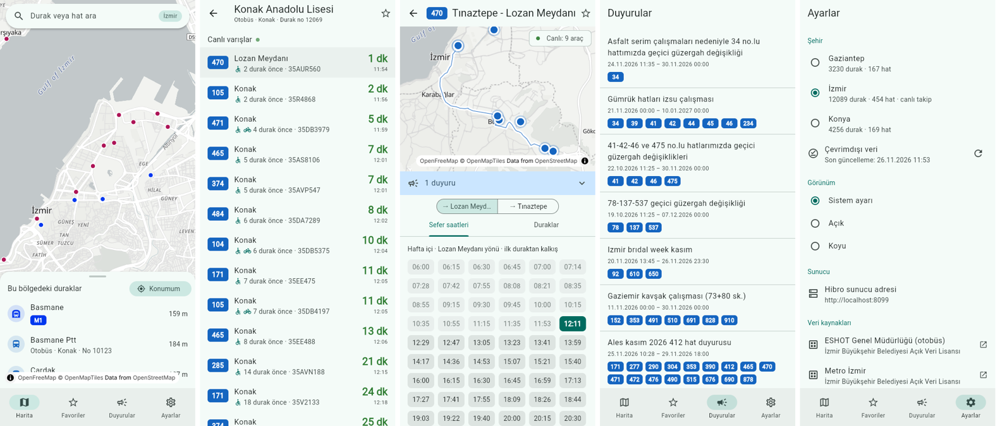
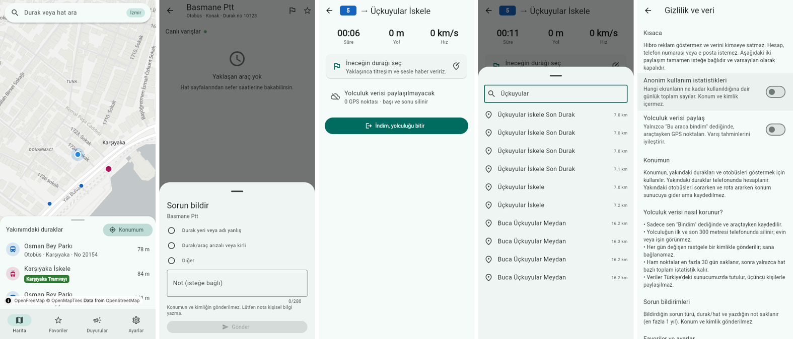

# Geliyo

> Uygulamanın adı **Geliyo**; bu GitHub reposu ve sunucu içindeki teknik adlar (`hibro-server`, `HIBRO_*` ayarları) eski çalışma adı **Hibro**'dan kalmadır.

**Reklamsız, hızlı, açık veriyle çalışan toplu taşıma uygulaması.** Moovit, Ekomobil ve benzeri uygulamalara alternatif.

> Durum: **Çalışan MVP** (Kasım 2026). **17 şehir:** İzmir (canlı otobüs takibi, metro, tramvay, İZBAN), Konya, Gaziantep, Kocaeli ve topluluk verisiyle Antalya, Adana, Muğla, Erzurum, Ordu, Düzce, Mardin, Çanakkale, Burdur, Osmaniye, Safranbolu, Kırklareli, Kastamonu.





**Rota planlama:** Kendi RAPTOR planlayıcımız 16 şehirde çalışıyor; İzmir'de otobüs + metro + tramvay + İZBAN aktarmalı.

## Repo yapısı

| Klasör | İçerik |
|---|---|
| [`server/`](server/) | Go API sunucusu: belediye verisini toplar, cache'ler, tek tip JSON sunar |
| [`app/`](app/) | Flutter uygulaması (Android, iOS, web) |
| [`deploy/`](deploy/) | Türkiye VPS kurulumu: Docker Compose + otomatik HTTPS, adım adım rehber |
| [`docs/`](docs/) | Yol haritası, veri envanteri, mimari, kararlar, [veri toplama politikası](docs/VERI_TOPLAMA.md) |

## Hızlı başlangıç

```bash
# Sunucu
cd server && go run ./cmd/hibro-server            # http://localhost:8080
# Uygulama (başka terminalde)
cd app && flutter run --dart-define=HIBRO_API=http://localhost:8080
```

## Neden Geliyo?

| Sorun (Moovit vb.) | Geliyo'nun cevabı |
|---|---|
| Tam ekran reklamlar, banner'lar, "Premium'a geç" baskısı | **Hiç reklam yok. Hiçbir zaman.** Reklam SDK'sı koda girmeyecek. |
| Ağır uygulama (100+ MB), yavaş açılış | Hedef: **< 1 sn soğuk açılış**, akıcı harita, gereksiz SDK yok |
| Konum ve kullanım verisinin reklam ağlarıyla paylaşılması | İzleyici (tracker) yok. Analitik yalnızca opt-in ve kendi sunucumuzda. |
| İnternet yoksa çalışmaz | **Çevrimdışı mod:** hat, durak ve sefer saatleri cihazda |
| Belediye verisinden gecikmeli veya hatalı bilgi | Doğrudan belediye GTFS ve canlı API'lerinden veri, şeffaf kaynak gösterimi |

## Dokümanlar

- [`docs/ROADMAP.md`](docs/ROADMAP.md): Fazlara ayrılmış yol haritası, hedef metrikler
- [`docs/VERI_KAYNAKLARI.md`](docs/VERI_KAYNAKLARI.md): Türkiye'deki tüm açık GTFS ve API kaynakları (test edilmiş)
- [`docs/MIMARI.md`](docs/MIMARI.md): Teknik mimari ve teknoloji seçimleri
- [`data/feeds.yaml`](data/feeds.yaml): Veri hattının okuyacağı makine-okunur feed listesi
- [`docs/kararlar/`](docs/kararlar/): Mimari kararlar (001: Flutter)

## İlkeler

1. **Reklamsız.** Gelir modeli bağış, isteğe bağlı destekçi üyeliği ve belediye/B2B lisansıdır. Kullanıcıya reklam gösterilmez.
2. **Hız bir özelliktir.** Her ekranın performans bütçesi var (bkz. ROADMAP, Metrikler).
3. **Gizlilik varsayılan.** Konum cihazdan çıkmadan rota hesaplanabilmeli (çevrimdışı mod).
4. **Açık veri, açık kaynak dostu.** Verinin lisansına uyulur, kaynak her zaman gösterilir.
